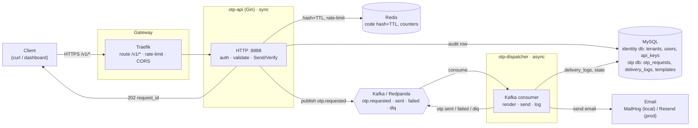
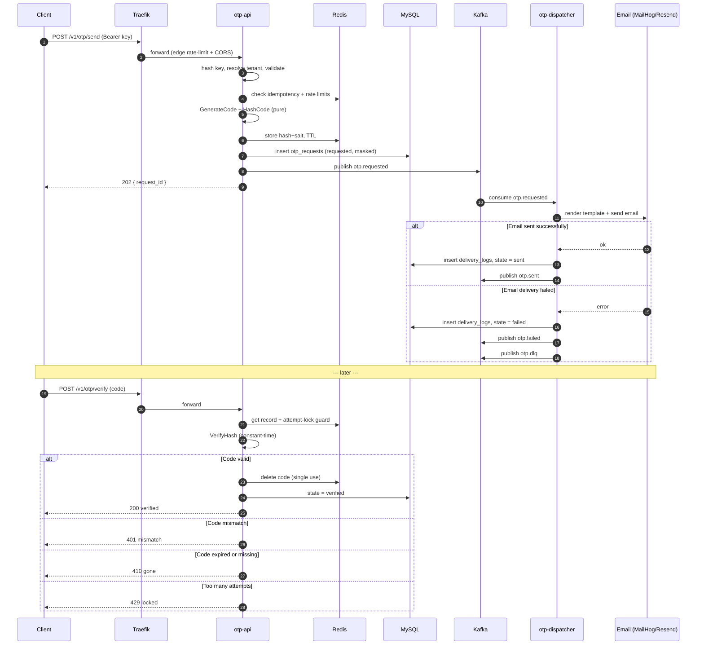
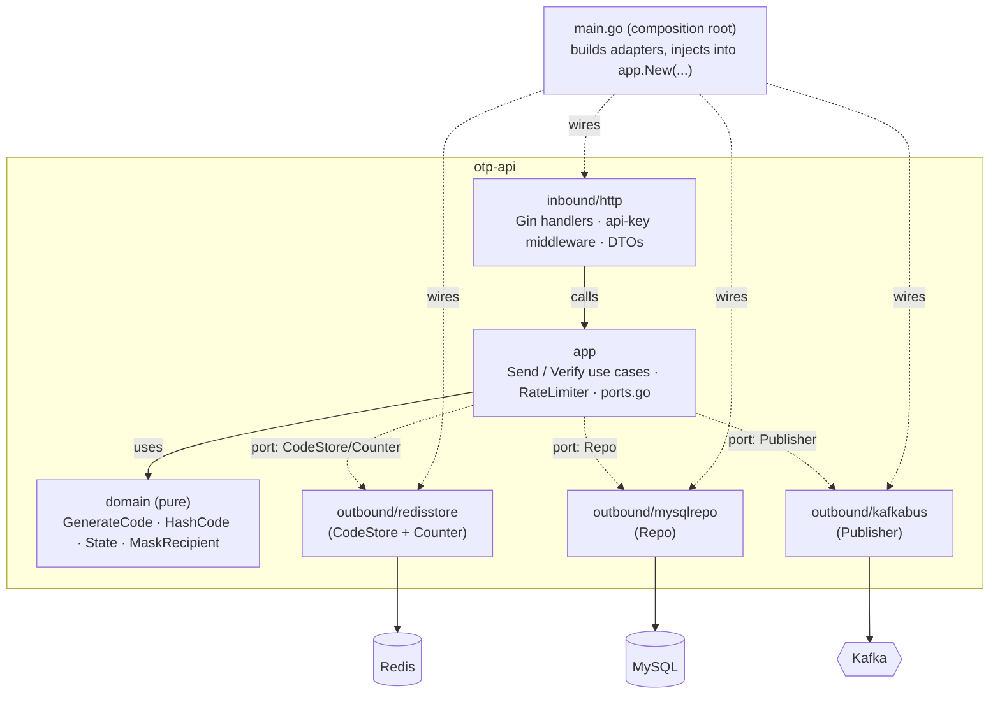
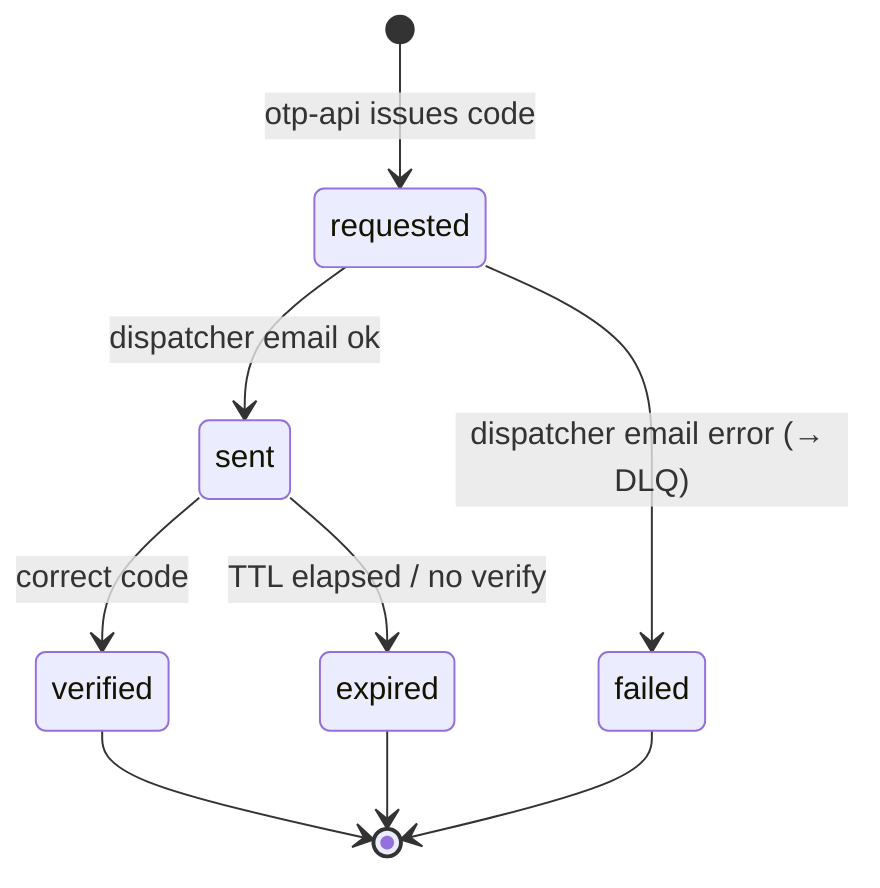
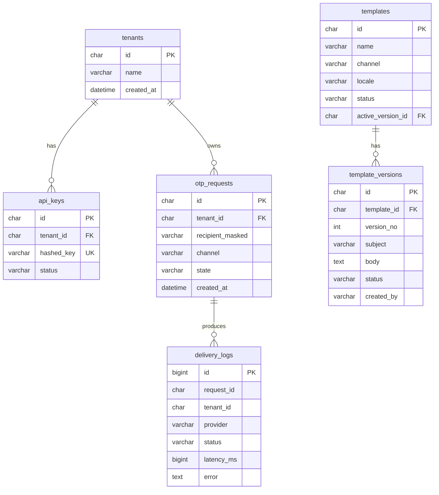
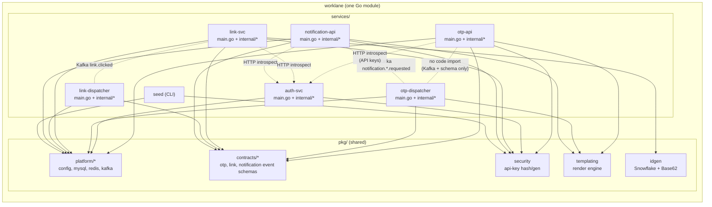
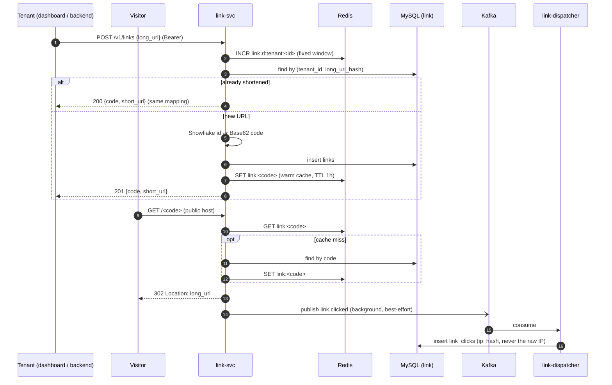
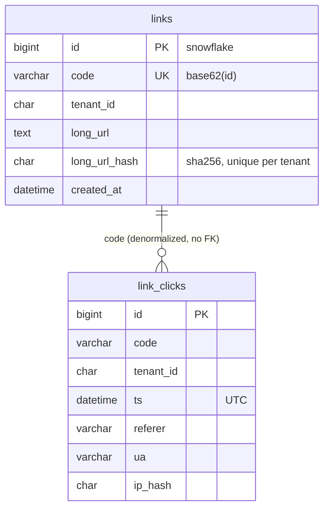
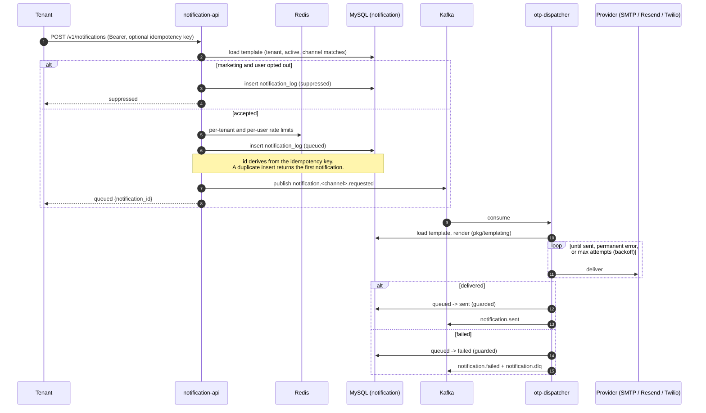
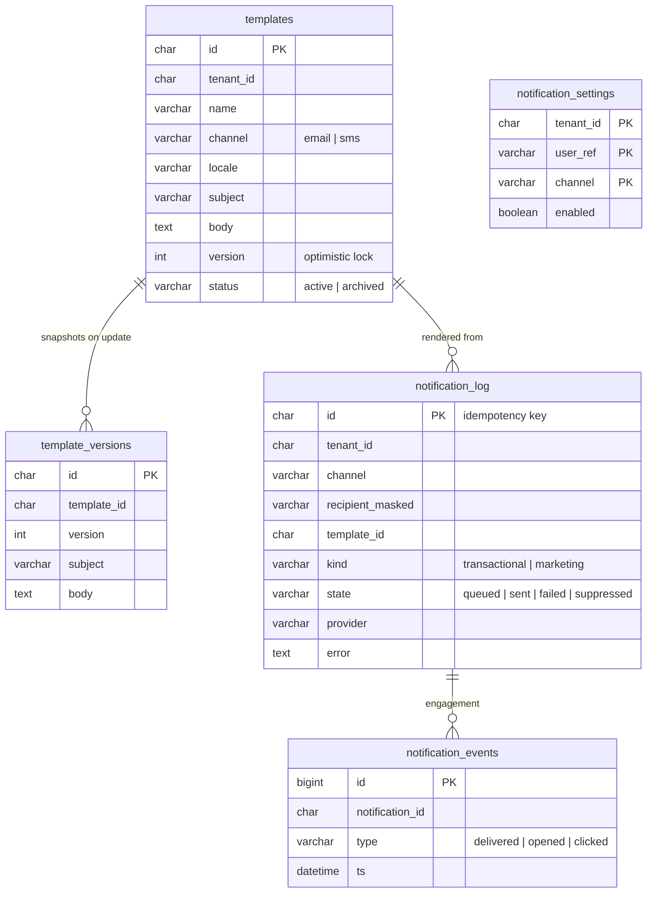

# Architecture (after Phases 1-4)

Visual reference for the OTP walking skeleton as actually built and running. Diagrams are Mermaid
(render in GitHub, most IDEs, or any Mermaid viewer). For the folder layout and the GoFrame→Gin
mapping see [reference/architecture-and-layout.md](./reference/architecture-and-layout.md); for the
concept-by-concept learning notes see [learning/go-notes.md](./learning/go-notes.md).

---

## 1. Runtime topology (docker-compose stack)

What runs, and how a request flows through it. The two services share nothing at runtime except the
MySQL schema and the Kafka event contract - they talk only over Kafka.

Dev-only web UIs (also in compose, not part of the request path): Adminer (MySQL), RedisInsight,
Redpanda Console, MailHog, Traefik dashboard.

**Auth & identity:** human login (email+password -> EdDSA JWT) and machine API keys are owned
by a dedicated `auth-svc` backed by its own `identity` database (tenants, users, api_keys).
otp-api verifies JWTs locally with the public key, and resolves API keys by calling auth-svc's
network-internal `/internal/introspect` (Redis-cached). See
[dashboard-auth-identity-service-design](superpowers/specs/2026-08-19-dashboard-auth-identity-service-design.md).

---

## 2. End-to-end sequence (send, then verify)

---

## 3. Hexagon inside one service (otp-api)

Dependencies point inward only. The inbound adapter drives a use case; the use case depends on ports;
outbound adapters implement those ports. The composition root (`main.go`) is the only place that knows
the concrete adapters.

`otp-dispatcher` has the same shape: inbound is a Kafka consumer, the use case is `Handle`, and the
outbound ports are `EmailProvider` (resendmail **or** smtpmail, chosen by config), `Repo`, `Publisher`.

---

## 4. OTP request state machine

Enforced in `domain/state.go` (allowed transitions) and driven by the two services.

---

## 5. Data model (MySQL)

> Database-per-service: `tenants`, `users`, and `api_keys` live in the **identity** database
> (owned by auth-svc); `otp_requests`, `delivery_logs`, and `templates` live in the **otp**
> database (owned by otp-api). The relationships below are logical - `tenant_id` is a soft
> reference across databases, with no cross-database foreign key.

> Note: the plaintext OTP code lives **only** in Redis (as a salted hash, TTL-bound) and is never in
> MySQL. `otp_requests.recipient_masked` stores `d***@gmail.com`, not the real address.

> **Template Studio (sub-project A):** `templates` is a logical entity (one per `channel` + `locale`),
> and each edit appends an immutable `template_versions` row. Publishing repoints
> `templates.active_version_id` (`draft → published → superseded`). The dispatcher resolves the
> active template for `(channel, locale)` via **Redis cache-aside** (`tmpl:{channel}:{locale}`,
> invalidated by otp-api on publish) and renders it through the shared `pkg/templating` engine -
> the same code the dashboard preview calls, so a preview cannot diverge from what is delivered.
> If no active row exists (or on any DB/cache error) the dispatcher **falls back to the env-config
> template**, so OTP delivery never breaks. Variables are the allowlisted `{{code}}` and `{{expiry}}`.

---

## 6. Monorepo, deployables

Services never import each other's `internal/` (Go enforces it). otp-api and otp-dispatcher meet at
the shared `pkg/contracts` event schema and the `otp` database; otp-api calls auth-svc over HTTP for
API-key introspection. Those boundaries keep each service independently deployable and, later,
independently extractable into its own repo. link-svc / link-dispatcher and notification-api /
otp-dispatcher follow the same sync-API + async-worker split (sections 7 and 8).

---

## 7. Link Service (sub-project C)

> **Status (2026-10-12):** code-complete against the
> [link service spec](superpowers/specs/2026-08-19-link-service-url-shortener-design.md) and covered
> by in-process tests (faked ports, sqlite, miniredis). The compose / Traefik / CI wiring and
> `test/e2e/link_test.go` have **not been run against real infrastructure yet**, and there are no
> k8s manifests for these two services.

`link-svc` owns the `link` database and the redirect hot path; `link-dispatcher` only appends
clicks. They share the schema and the `link.clicked` contract, never code.

Why it is built this way:

- **Snowflake -> Base62, not an auto-increment.** A plain counter makes codes enumerable
  (`code+1`) and leaks volume. A Snowflake id packs `[41 bits ms | 10 bits node | 12 bits seq]`, so
  ids are unique without a DB round trip. Pitfall: every replica needs its own `LINK_NODE_ID`
  (0..1023) or two pods can mint the same code; the setting is parsed strictly for that reason.
- **302, not 301.** Browsers cache a 301 and stop calling the service, which silently ends click
  tracking for that visitor.
- **The redirect never waits on Kafka.** The click is published on a detached goroutine behind a
  bounded semaphore (`LINK_MAX_INFLIGHT_CLICKS`); when the broker is slow, clicks are dropped
  rather than piling up goroutines. Analytics is best-effort, the redirect is the product.
- **Dedup needs a hash column.** `long_url` is `TEXT` and cannot carry a unique index, so
  `(tenant_id, sha256(long_url))` is the dedup key. The check-then-insert race is settled by that
  unique index: the loser re-reads and returns the winner's code.
- **Clicks are at-least-once.** A redelivered `link.clicked` double-counts; that is accepted for
  analytics. A poison message is logged and dropped so it cannot stall its partition.

---

## 8. Notification Service (sub-project B)

> **Status (2026-10-12):** code-complete against the
> [notification system spec](superpowers/specs/2026-08-19-notification-system-design.md) and covered
> by in-process tests. **Not run against real infrastructure yet** (compose, Traefik, CI images,
> `test/e2e/notification_test.go`, SMTP), and there are no k8s manifests. Open items are listed in
> the [roadmap](roadmap/2026-08-16-notification-platform-and-link-service.md).

`notification-api` accepts and records a send; delivery happens in `otp-dispatcher`, which gains a
second set of handlers that are **opt-in**: they start only when `NOTIFICATION_MYSQL_DSN` is set, so
an OTP-only deployment is unchanged.

Why it is built this way:

- **Idempotency is in the primary key.** `notification_log.id` is derived from
  `(tenant, idempotency key)`, so a client retry hits a duplicate-key insert and gets the first
  notification back instead of sending twice. Designing this in from the start is far cheaper than
  bolting a dedup table on later.
- **Guarded state transitions.** The dispatcher updates a row only from an allowed prior state
  (`failed` only from `queued`; `sent` from `queued` or `failed`), so a redelivered Kafka message
  cannot flip a `sent` row back to `failed`. `sent` may overwrite `failed` because notification-api
  marks a row failed when its publish reports an error, and the message may still have gone out.
- **Opt-out only applies to marketing.** Suppressing a transactional message (a receipt, a login
  code) is a bug, so only `kind = marketing` consults `notification_settings`.
- **Permanent vs transient errors.** A 5yz SMTP reply is a definitive rejection and fails
  immediately; 4yz replies and network errors are retried with backoff. Retrying an unknown
  mailbox `MaxAttempts` times only delays the DLQ entry.
- **Rendered subjects are always one line.** The renderer collapses CR/LF in the subject, because a
  tenant-supplied variable containing a line break would otherwise inject mail headers.
- **Preview uses the delivery renderer.** `POST /v1/templates/:id/preview` calls the same
  `pkg/templating` code path as the dispatcher, so a preview cannot diverge from what is sent.

Pitfall still open: `{{link "url"}}` needs a shortener. `notification-api` currently wires a
`noShortener`, so such a template fails with `templating.ErrNoShortener` until the link-svc adapter
exists (blocked on how a service authenticates to link-svc on a tenant's behalf).

> These `templates` live in the **notification** database and are tenant-scoped. They are separate
> from the OTP `templates` in section 5, which the dashboard's Templates screen still uses.
