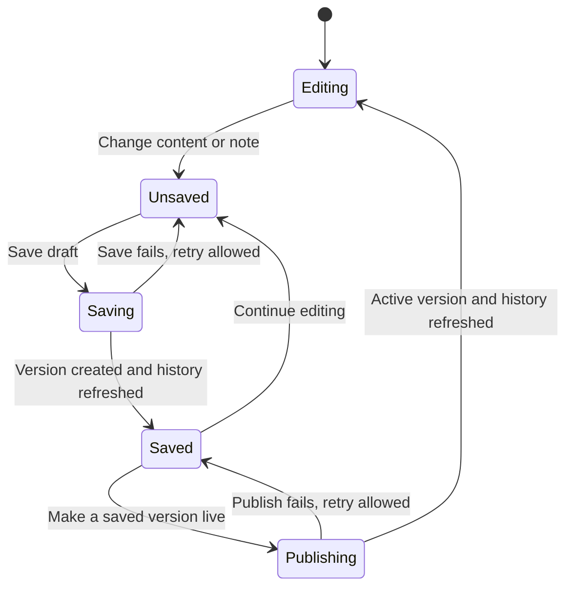

# Dashboard interaction feedback

Playground, Requests and Template Studio favor immediate feedback for repeated
actions. Navigation and completed results do not wait for entrance animations.
Pending actions use a spinner with a text label; reduced motion stops rotation.

| Before | After | Reason |
| --- | --- | --- |
| OTP handoff populated the verification form without moving focus | Focus moves to the code input | The next Enter verifies the populated code |
| Request detail unmounted the table and reset pagination and sorting | The hidden table stays mounted; Back restores row focus and scroll | Returning preserves the investigation context |
| Nested table controls could activate their row | Button clicks and keyboard actions stay within the control | Copying an ID does not open detail |
| Pressing a wide table row scaled its nested Copy button away from the pointer | Rows use background feedback and keep their geometry fixed | Pointer down and up remain on the same control, including with motion enabled |
| Draft saves had no dirty, pending or completion feedback | Editing, unsaved, saving and saved states appear beside the action | Repeated saves cannot silently create duplicate versions |
| Publishing could replace unsaved editor content | Save changes before publishing; editing pauses until refreshed version data arrives | The active-version change can safely reseed the editor |
| Preview errors displayed unrendered source as output | Preview shows updating or error states and ignores obsolete responses | Only output for the current content is presented as rendered delivery content |

The existing versioning API and server renderer remain authoritative. Preview
requests retain the 250 ms debounce. Drafts remain local until saved, and leaving
the template editor does not persist unsaved changes.

Verification uses `pnpm test`, `pnpm typecheck` and `pnpm lint` from
`dashboard/`. Browser checks cover the OTP handoff with Enter, request pagination
and focus restoration, and draft save/publish/preview in dark, light and narrow
layouts using the mock data source. Component tests cover preview and publish
failure feedback without contacting production services.
