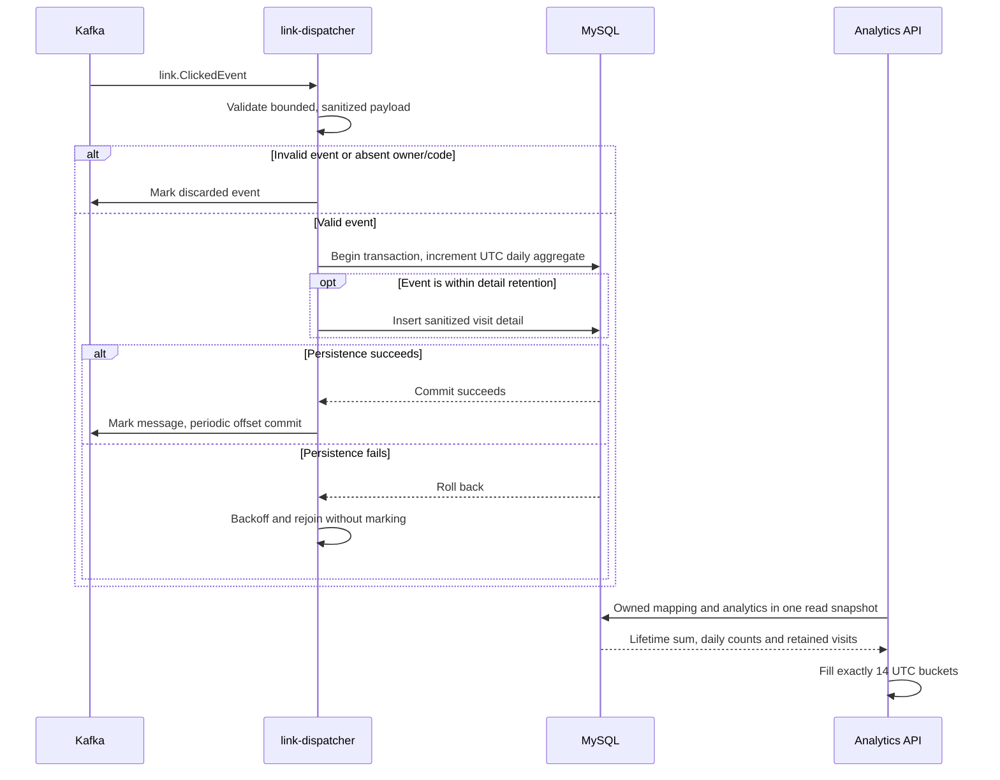

# Click persistence, retention and analytics

Implements [#15](https://github.com/DiiKhanh/worklane/issues/15) under the
[approved MVP specification](../roadmap/2026-11-15-link-service-mvp-scope.md)
and [ADR 0001](../adr/0001-link-redirects-and-best-effort-analytics.md).
The existing [redirect producer](link-redirects.md) remains independent of
analytics availability. Dashboard integration and stack routing remain in
#16 and #17. No production deployment is part of this increment.

## Persistence and consumer progress

`link-dispatcher` consumes the configured click topic through the existing
typed Kafka envelope. Validation bounds the envelope to 2,048 bytes, rejects
unknown envelope/payload fields and invalid UTF-8, and accepts only canonical
codes, bounded ASCII tenant identifiers, supported device categories and
HTTP/HTTPS origins without credentials, paths, queries or fragments. Origins
are limited to 512 ASCII bytes. Timestamps must be nonzero, representable in
MySQL and no later than the ingestion clock. Non-UTC offsets normalize to UTC
before millisecond storage and daily bucketing. Future timestamps are rejected;
service clocks need synchronization.

Malformed events and tenant/code pairs absent from the mapping table are
discarded with an aggregate rejection count. Payloads and dependency errors
are never logged or sent to a dead-letter topic. A valid event increments its
daily aggregate and inserts any retained visit in one InnoDB transaction.
Disabled mappings remain eligible for previously emitted clicks.

Kafka progress is marked only after that transaction commits, or after a
permanently invalid event is discarded. Each write attempt has a two-second
deadline. A persistence failure rolls back, waits one second, and ends the
claim without marking the message. Sarama cancels the session and rejoins at
committed progress, including after process restart. A later message in that
partition cannot advance past the failed write. Successful writes whose Kafka
progress was not committed may replay and increment again, as allowed by the
accepted at-least-once semantics. No event ID or deduplication is introduced.



## Retention

Daily aggregates remain for the lifetime of the mapping. A detail timestamp at
or before ingestion time minus 30 days is expired and is never inserted on
delayed delivery, even though its daily aggregate increments. Reads exclude
expired details immediately, independently of cleanup progress.

The dispatcher starts detail cleanup at startup and repeats every minute.
Deletion uses the timestamp index in batches of at most 1,000 rows, with a
two-second deadline for each batch. Full batches drain immediately; errors
are redacted and retried on the next scheduled pass. Cleanup never modifies
daily aggregates. Physical deletion normally follows logical expiration on
the next pass; a stopped dispatcher or database outage delays physical cleanup.
The deployment needs the dispatcher running and cleanup failures monitored
to enforce the storage retention policy. Shutdown cancels cleanup and
consumption within a shared ten-second process budget.

Before consuming, the dispatcher creates the topic if absent or incrementally
updates only these settings on an existing topic:

| Setting | Value |
| --- | --- |
| `cleanup.policy` | `delete` |
| `retention.ms` | `604800000` (seven days) |
| `segment.ms` | `3600000` (one hour) |
| `file.delete.delay.ms` | `60000` (one minute) when supported by the broker |
| `message.timestamp.type` | `LogAppendTime` |

Broker append time prevents producer clock skew from extending Kafka retention.
Seven days leaves substantial margin below the 30-day raw-event limit because
[Kafka retention works on whole segments and asynchronous deletion](https://kafka.apache.org/39/configuration/topic-level-configs/).
The broker retention check interval must remain bounded below that margin
(the Kafka default is five minutes); broker failure or stopped cleanup cannot
provide a physical deletion deadline. The local Redpanda broker uses its own
segment deletion process and omits Kafka's per-topic file deletion delay from
its reported settings. The topic initializer requires topic
creation/configuration permissions and fails startup if it cannot establish
the policy. Existing partitions, replication and unrelated settings are
preserved. New topics use one partition and one replica for the standalone MVP.
Production permissions and rollout belong to the separately approved deployment.

## Authenticated analytics API

`GET /v1/links/:code/analytics` uses existing Bearer JWT/API-key authentication.
Tenant identity comes only from authentication. A foreign, absent or invalid
code returns the same `404 {"error":"link: not found"}`. A disabled link
retains analytics access for its owner.

The reader uses one read-only repeatable-read transaction for ownership,
lifetime sum, recent daily counts and visits. Concurrent ingestion cannot
produce a recent visit without its aggregate in the same response. SQL uses
parameterized tenant/code predicates throughout.

Successful responses contain:

- `total_clicks`: lifetime sum of daily aggregates, including expired details.
- `series`: exactly 14 oldest-first UTC dates, including today, with missing
  dates filled with zero. Event time determines the day.
- `recent`: at most 20 retained visits ordered by timestamp descending, then
  insertion ID descending for ties. Only UTC timestamp, origin and device are
  exposed; an empty list encodes as `[]`.

Analytics reads have a two-second budget and `Cache-Control: no-store`.
Unavailable analytics returns `503 {"error":"link: unavailable"}`, never
partial data or a fabricated zero. Metadata/list/copy paths do not call the
analytics reader. Counts describe approximate recorded redirect activity,
including bots, repeated requests, event loss and redelivery duplicates.
The normal-operation visibility target is ten seconds; outages have no
visibility guarantee. Manual refresh is sufficient.

## Configuration and verification

Run `link-svc` migrations before starting the dispatcher. Both deployables use
the Link database; the dispatcher does not migrate it. `MYSQL_DSN` is required
and supports the existing `_FILE` secret-file convention. Optional Kafka
settings are `KAFKA_BROKERS` (default `localhost:9092`), `KAFKA_TOPIC_CLICKED`
(default `link.clicked`) and `KAFKA_GROUP` (default `link-dispatcher`).
The consumer logs only aggregate rejection/persistence-failure counts at shutdown,
plus fixed messages for cleanup, startup or fatal consumer failure.

```sh
make test-link
make test-link-integration
make test-link-schema
go build ./...
go vet ./...
make test
```

The three agreed test seams are authenticated analytics HTTP, real
Kafka-to-MySQL ingestion, and detail-retention operations against isolated
MySQL. Integration tests use testcontainers by default. Existing
`LINK_TEST_MYSQL_SOCKET`, `LINK_TEST_REDIS_URL` and `LINK_TEST_KAFKA_BROKERS`
overrides support disposable local dependencies without Docker. Each dispatcher
test creates its own database, topic and consumer group. Overrides must never
target production or a shared cluster.

Tests cover real zero versus unavailable analytics with metadata still usable;
JWT/API-key ownership; disabled history; 14 UTC buckets across midnight and
non-UTC clocks; lifetime totals; newest-20 and expired detail filtering; actual
Kafka ingestion within ten seconds; duplicate counting; rollback after a detail
insert failure with no Kafka progress; restart/redelivery; invalid and raw
metadata rejection; UTC event-time bucketing; retention boundary/late events;
and idempotent topic configuration. Browser and five-minute load acceptance
remain in #16/#17.

### Local acceptance evidence

Verified on 2026-11-21 with Go 1.25.0, isolated MySQL 8.0.42 over a Unix
socket, Redis 5.0.7 and Kafka 3.9.0 over loopback. Docker is unavailable on
this host, so testcontainers startup was not exercised. The adapters used
their real dependencies; authentication introspection used the existing HTTP
contract fixture. Retention boundaries used injected clocks.

| Check | Result |
| --- | --- |
| `make test-link` | Passed with the race detector |
| `make test-link-integration` | Passed with real MySQL, Redis and Kafka, with the race detector |
| `make test-link-schema` | Passed against isolated MySQL |
| `go build ./...`, `go vet ./...` | Passed |
| `make test` | Full default backend suite passed |
| Compiled dispatcher smoke | Startup detail cleanup, Kafka ingestion visible in 106 ms, graceful SIGTERM shutdown |
| Mermaid sequence diagram | Rendered and visually inspected |

The smoke timing is a local sample, not a production guarantee. No production
deployment, data mutation, messaging or backup/restore operation was performed.

### Referrer compatibility regression and revalidation

Revalidated on 2026-11-27 against source based on `591d9e4` with the
producer-side referrer correction. The isolated dependencies were MySQL
8.0.42, Redis 5.0.7 and Apache Kafka 3.9.0; checks used Go 1.25.0.

Before correction, an active public GET with `Referer: https://例.com/private`
returned 302 and published a Unicode origin that the dispatcher rejected.
An ASCII control request incremented analytics to one, but the Unicode request
left the total at one after ten seconds. Origins exceeding 512 bytes had the
same producer/consumer incompatibility. HTTP and real-Kafka regression tests
failed before the implementation changed.

Unsupported origins now become unknown before queue admission. The consumer
continues to reject malformed events. Regression coverage includes Unicode
hosts, oversized origins, ASCII hosts with Unicode paths, punycode hosts,
GET-only publication and sanitized real Kafka payloads.

| Check | Result |
| --- | --- |
| `make test-link` | Passed with the race detector |
| `make test-link-integration` | Passed with the race detector and isolated real dependencies |
| `make test-link-schema` | Passed against isolated MySQL |
| `make test`, `go build ./...`, `go vet ./...` | Passed |
| Compiled HTTP to Kafka to MySQL to authenticated analytics API | Unicode and oversized referrers both incremented totals with unknown origins, visible after 41 ms and 39 ms respectively |

These timings are local samples. Testcontainers startup was not exercised;
the existing disposable-dependency overrides selected the isolated processes.
The checks establish backend acceptance for #15; browser and load acceptance
remain in #16/#17. This revalidation did not change CI coverage or production.
