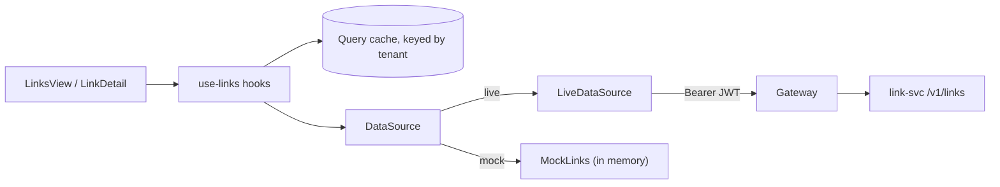
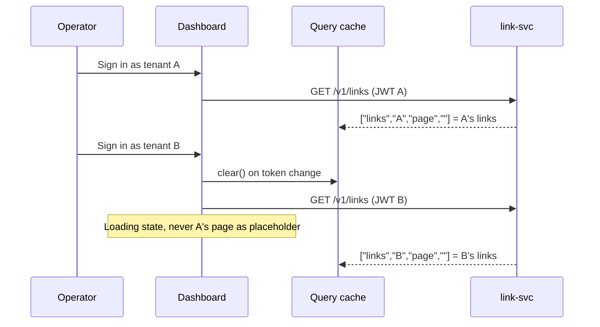

# Links dashboard

Implements [#16](https://github.com/DiiKhanh/worklane/issues/16) under the
[approved MVP specification](https://github.com/DiiKhanh/worklane/issues/11).
The Links screen replaces its design-kit fixtures with live create, copy,
list, detail, analytics and permanent-disable workflows against the
[management API](link-management.md) and [analytics API](link-analytics.md).
Stack routing and full MVP verification remain in #17. No production deployment
is part of this increment.

## Data flow

The screen follows the dashboard's existing architecture: components call
TanStack Query hooks (`lib/queries/use-links.ts`), hooks call the single
`DataSource` interface, and `NEXT_PUBLIC_DATA_SOURCE` selects the live HTTP
adapter or the in-memory mock. Live link requests use the shared gateway
(`NEXT_PUBLIC_API_BASE`) with the operator's JWT, like every other live screen.
The gateway must route `/v1/links*` to link-svc; wiring that route into the
compose stack belongs to #17.

| Screen action | Request | Result |
| --- | --- | --- |
| Create | `POST /v1/links` | 201 "created" or 200 "existing link returned", both with the server's `short_url` |
| List | `GET /v1/links?cursor=` | 20 per page, newest first; Previous/Next walk the visited cursors |
| Detail | `GET /v1/links/:code` | Metadata and state, independent of analytics |
| Analytics | `GET /v1/links/:code/analytics` | Lifetime total, 14 UTC days and up to 20 recent visits; manual Refresh |
| Disable | `POST /v1/links/:code/disable` | Sent only after a confirmation dialog |

Short URLs are always the `short_url` the API returns, built by link-svc from
`LINK_PUBLIC_BASE`. The dashboard never composes a short host itself.

## Failure states

Metadata and analytics are separate queries, so either can fail without hiding
the other. A failed analytics read renders an "Analytics unavailable" panel with
Retry and never shows zero; the heading, Copy link and Disable remain usable. A
failed refresh keeps the last loaded analytics and says so. A failed list shows
"Links unavailable" with Retry.

Create errors map to the API's statuses: 400 explains the destination policy,
409 `LINK_DISABLED` says the URL belongs to a permanently disabled link that
cannot be re-enabled or replaced, 429 shows the `Retry-After` delay, and 503
asks to retry shortly. The form also rejects non-HTTP(S) and over-4,096-byte
input before sending; link-svc remains authoritative for the rest of the policy.

## Tenant isolation in the cache

Two independent guards keep one tenant's links out of another's view:

1. Link query keys start with `["links", tenant]`, where `tenant` is the
   `tenant_id` claim read (unverified) from the session JWT. The claim only
   partitions the client cache; link-svc authorizes every request from the
   verified token. Live link queries stay disabled until a tenant is known.
   Page transitions keep the previous page visible only when it belongs to the
   same tenant, so a slow first page for a new tenant shows a loading state.
2. `Providers` clears the whole query cache whenever the session token changes
   (login, re-login or the automatic sign-out on 401). This also covers screens
   whose keys are not tenant-scoped.

## Mock mode

`MockLinks` mirrors the API semantics the screen depends on (exact-string dedup,
permanent disable, 409 on disabled dedup, cursor pages, 14 UTC days) on the
reserved `short.example` host. The top bar labels this mode "Mock data", and the
mock is never used when `NEXT_PUBLIC_DATA_SOURCE=live`.
