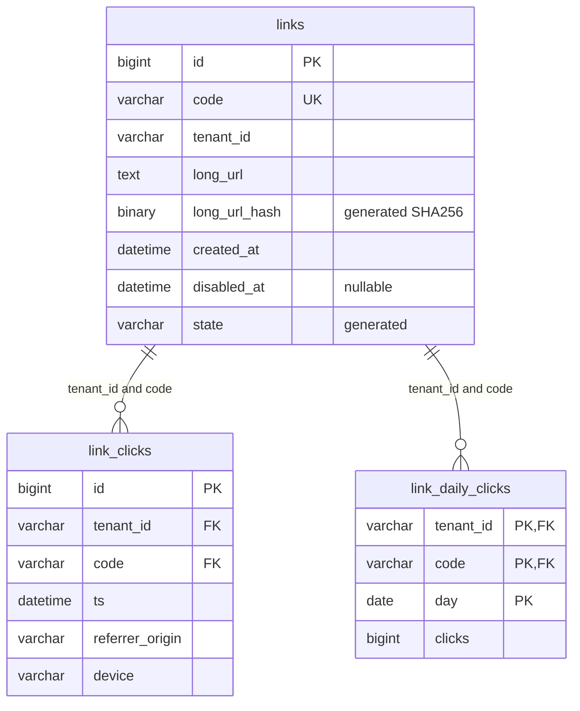

# Link Service contracts and storage

Implements the shared foundations in [#12](https://github.com/DiiKhanh/worklane/issues/12).
The authoritative behavior is [#11](https://github.com/DiiKhanh/worklane/issues/11)
and the [confirmed MVP scope](../roadmap/2026-11-15-link-service-mvp-scope.md).
This increment defines wire types, migrations and code generation. HTTP handlers,
authentication wiring, URL validation, cache/quota behavior, event sanitization,
ingestion, cleanup scheduling and the live dashboard belong to #13-#17.
Tenant management from #13 is implemented in [link-management.md](link-management.md).
Click persistence and analytics from #15 are implemented in [link-analytics.md](link-analytics.md).

## HTTP contract

The executable Go wire types are in
[dto.go](../../services/link-svc/internal/adapters/inbound/http/dto.go).
Management and analytics use the existing Bearer JWT/API-key authentication.
Tenant identity comes exclusively from authentication; no request accepts a
tenant ID. A foreign tenant's code returns the same 404 as an absent code.

| Method and path | Request | Success response |
| --- | --- | --- |
| `POST /v1/links` | JSON `CreateRequest`: `{long_url: string}` | 201 new or 200 active dedup; `CreateResponse`: `{code: string, short_url: string}` |
| `GET /v1/links` | `ListRequest` query: optional `cursor`, `limit` | 200 `ListResponse`: `{items: Metadata[], next_cursor: string \| null}` |
| `GET /v1/links/:code` | Case-sensitive code path parameter | 200 `Metadata` |
| `GET /v1/links/:code/analytics` | Case-sensitive code path parameter | 200 `AnalyticsResponse` |
| `POST /v1/links/:code/disable` | Case-sensitive code; no body | 200 `Metadata`, including on repeated disable |
| `GET /:code` | Public case-sensitive code | 302 with exact destination in `Location`; response body is not a JSON contract |
| `HEAD /:code` | Same public resolution as GET | Same status and headers; no body and no click |
| `GET /healthz` | Public; no parameters | 200 `HealthResponse`: `{"status":"ok"}`, process-only |

`Metadata` has this shape, independently of analytics availability:

```json
{
  "code": "aZ1",
  "short_url": "https://short.example/aZ1",
  "long_url": "https://example.com/?b=2&a=1#section",
  "state": "active",
  "created_at": "2026-11-15T12:00:00.123Z",
  "disabled_at": null
}
```

State is `active` or `disabled`. Disabled links keep their mapping and history;
`disabled_at` is a non-null, immutable timestamp. Repeating disable returns the
original timestamp. Creating the destination of a disabled link conflicts;
it never creates a replacement or reactivates the link.

`short_url` is constructed from configured `LINK_PUBLIC_BASE`. Destination
strings retain query order, fragments, casing and trailing slashes. The accepted
URL has at most 4,096 UTF-8 bytes, not 4,096 characters. The creation handler must
apply the full URL policy from #11 before calling application code. Gin's
`required` tag alone does not implement that policy.

List defaults to 20 items, with an explicit limit of 1-100. Results order by
`created_at DESC, id DESC`. The opaque cursor identifies that ordering position
within the authenticated tenant; a later page uses the strict older-than
predicate on the pair. Cursor values are bounded to 256 bytes and never select
another tenant. Invalid cursors/limits return 400. `next_cursor: null` marks the
last page; empty results encode `items: []`.

`AnalyticsResponse` has the following fields:

| Field | Shape and meaning |
| --- | --- |
| `total_clicks` | Nonnegative integer, lifetime recorded redirect activity |
| `series` | Exactly 14 `{date: "YYYY-MM-DD", clicks: integer}` UTC buckets, oldest first, including today; missing days filled with zero |
| `recent` | Up to 20 `{ts: RFC3339 UTC, referrer_origin: string, device: string}` visits, newest first, within retained details |

An unknown referrer is `""`; device is `desktop`, `mobile`, `tablet` or `unknown`.
Empty recent results encode `[]`. An old link can have no recent details while
retaining nonzero totals. Analytics failure returns an error response; a zero
count is reserved for a successful read that found zero recorded visits.
Counts remain approximate under [ADR 0001](../adr/0001-link-redirects-and-best-effort-analytics.md).

### Errors and response headers

All JSON errors preserve the repository's `{"error": string}` envelope; no
additional error object, stack trace, raw destination or dependency error is
returned. HEAD uses the same status and headers without a JSON body.

| Status | `error` | Applies to | Retry behavior |
| --- | --- | --- | --- |
| 400 | `link: invalid request` | Invalid create body, destination, cursor or limit | Correct the request |
| 401 | `missing credentials`, `invalid token`, `invalid api key` | Management/analytics auth, following existing middleware | Supply valid credentials |
| 404 | `link: not found` | Absent/foreign management or analytics code; confirmed absent public code | No automatic retry |
| 409 | `LINK_DISABLED` | Create dedup of a disabled destination | Permanent conflict |
| 410 | `LINK_DISABLED` | Disabled public code | Permanent disable |
| 429 | `link: rate limited` | Create quota or redirect ingress limit | Honor `Retry-After` seconds |
| 503 | `link: unavailable` | Unavailable quota storage, unsafe ID issuance, unresolved mapping or unavailable analytics | Retry with backoff |
| 503 | `auth temporarily unavailable` | Existing identity introspection unavailable | Retry with backoff |
| 500 | `internal error` | Unexpected internal failure | Generic, redacted failure |

Both active public redirect responses and public absent/disabled responses carry
`Cache-Control: no-store`. The redirect ingress may generate its own 429 body;
clients use its status and `Retry-After`, not a JSON shape controlled by the app.
Only active GET responses returning 302 record a click. Metadata routes never
require an analytics read. Creation includes active dedup in its configurable
quota, default 10/minute/tenant. Public status distinctions and dependency
fallbacks remain exactly as specified in #11.

## Click event contract

[pkg/contracts/link](../../pkg/contracts/link/event.go) is an infrastructure-free
shared kernel imported by the producer and consumer. `ClickedEvent` uses the
existing Kafka envelope (`msg_type: "link.ClickedEvent"`, `data: payload`). The
topic is `link.clicked`, passed through configuration at the infrastructure
boundary. Its partition key is the code.

```json
{
  "code": "aZ1",
  "tenant_id": "tenant-1",
  "ts": "2026-11-15T12:00:00.123Z",
  "referrer_origin": "https://example.com",
  "device": "mobile"
}
```

`ts` is the redirect's event time in UTC. Sanitize before queue admission:
retain only an HTTP/HTTPS origin without credentials, path, query or fragment;
missing/invalid origins become `""`. The persisted ASCII origin has a 512-byte
bound; invalid/oversized values become unknown rather than being truncated.
Device classification occurs before publishing. Raw User-Agent, raw referrer,
IP and IP hash are absent from the contract and storage. Producers and consumers
must validate their boundaries; the Go struct alone does not sanitize a string.
No raw metadata belongs in application logs.

Kafka and retained visit details must expire within 30 days. Daily aggregates
remain for the link lifetime. A delayed event older than the retention window
may increment its aggregate but must not recreate expired detail. Redelivery
may increment counts again; no event ID or deduplication guarantee is introduced.

## Service-owned MySQL schema

[db/link/migrations](../../db/link/migrations) is the schema source of truth.
Use MySQL 8.0.16 or newer with enforced CHECK constraints; no AutoMigrate.
The database is owned by Link Service, without cross-service tenant foreign keys.



- The global code key and all tenant/code joins use `ascii_bin`. A canonical
  Base62 CHECK rejects non-alphanumeric codes, leading zeros and whitespace;
  `a` and `A` remain distinct identities.
- The generated `BINARY(32)` SHA256 hashes the original URL's UTF-8 bytes.
  `(tenant_id, long_url_hash)` is unique even under concurrent insertion.
  Management code must verify original-string equality on a hash match and
  resolve duplicate-key races by loading the existing mapping. A hash collision
  must never return a different destination as dedup.
- Update/delete triggers preserve ID, code, tenant, URL and creation time and
  forbid deletion. Only a null `disabled_at` can transition to a timestamp;
  once present, it cannot be removed or changed. State is generated from it.
  DDL and administrative access remain outside these application invariants.
- `(tenant_id, created_at DESC, id DESC)` supports stable list pagination.
  Composite analytics foreign keys prevent a row's tenant/code mismatch.
- Detailed visits index `(tenant_id, code, ts DESC, id DESC)` for recent visits
  and `ts` for bounded retention deletion. Daily counts use the primary key
  `(tenant_id, code, day)`, supporting the UTC series and lifetime SUM.
- UTC `DATETIME(3)` values preserve millisecond precision. Persistence must
  normalize event time to UTC. Aggregate increment and retained detail insert
  belong to one transaction; retention cleanup only deletes visit details.

The down migration drops analytics before mappings and removes triggers. It is
for disposable tests or an explicitly authorized rollback, not routine service
lifecycle management.

## Unique code generation

[pkg/idgen](../../pkg/idgen) implements the established 41/10/12 Snowflake layout
with a fixed epoch of `2026-01-01T00:00:00Z`. `Next() (int64, error)` serializes
access to a generator; `Encode(uint64)` then produces its case-sensitive code
over `0123456789abcdefghijklmnopqrstuvwxyzABCDEFGHIJKLMNOPQRSTUVWXYZ`.
`Decode` rejects invalid, overflowing or noncanonical representations.

`NewSnowflake(nodeID, time.Now)` requires an explicit node ID in 0-1023.
The composition root must require `LINK_NODE_ID`, without a shared default.
Each live instance owns a distinct node ID and shares one generator across its
callers. Node allocation is a deployment responsibility. Restart fencing must
prevent reuse of that node until wall time exceeds its previous highest issued
timestamp; this in-memory library does not coordinate processes or persist a
high-water mark. Database primary/unique keys remain the final collision guard.

Each millisecond permits 4,096 IDs per node. Before-epoch clocks, rollback,
sequence exhaustion and the end of the 41-bit time range return explicit errors
without advancing generator state. Sequence exhaustion can be retried after time
advances. There is no unbounded waiting or sequence wrap; callers must surface
unavailable creation rather than retry forever. Codes are public identifiers,
not credentials, encrypted values or an unguessability mechanism.

## Verification

```sh
make test-link
make test-link-schema
go build ./...
go vet ./...
make test
```

`test-link` runs the generator and wire contracts under the race detector.
`test-link-schema` uses the repository's integration build tag and a disposable
MySQL testcontainer. Without Docker, `LINK_TEST_MYSQL_SOCKET` can point to a
separately initialized, disposable local MySQL server's Unix socket, with an
empty-password root account. Each run creates and drops only a uniquely named
test database; no existing database is migrated. Never point it at production.

Tests exercise known Base62 vectors and round trips, case distinctions and
overflow rejection; Snowflake limits, safe recovery and concurrent uniqueness
across distinct nodes; exact JSON shapes; real MySQL dedup/index constraints,
immutable lifecycle, analytics ownership, byte limits, retention independence
and migration rollback/reapplication. HTTP/browser tests require the workflows
from subsequent tickets and are outside this foundations increment.

### Local acceptance evidence

Verified on 2026-11-15 with Go 1.25.0 and a standalone MySQL 8.0.42 instance
using a Unix socket with TCP networking disabled. The socket integration path
passed; the Docker/testcontainers startup path was not exercised on this host.

| Check | Result |
| --- | --- |
| `make test-link` | Passed, including concurrent generation under the race detector |
| `make test-link-schema` | Passed against isolated MySQL, including rollback/reapply |
| `go build ./...` and `go vet ./...` | Passed with CGO enabled |
| `make test` | Full default backend suite passed |
| Base62 fuzzing, 3 seconds | Passed, 395,916 executions |
| Mermaid schema diagram | Rendered and visually inspected |
| Standards and spec review | No findings on either axis |

No production deployment or production data mutation was performed.
