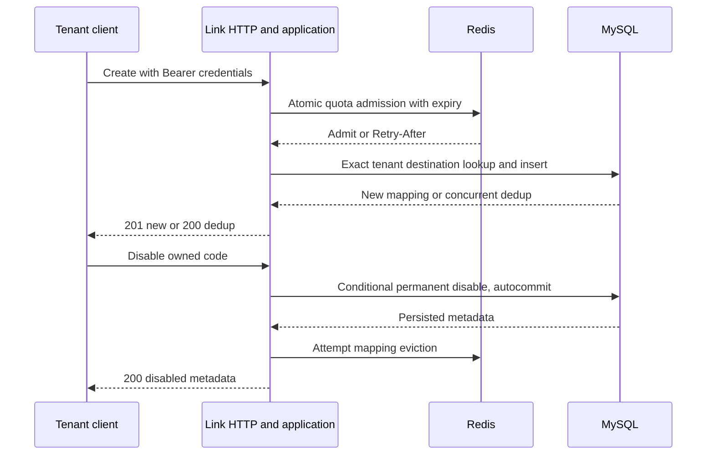

# Link management and permanent disable

Implements [#13](https://github.com/DiiKhanh/worklane/issues/13) using the
[approved MVP](../roadmap/2026-11-15-link-service-mvp-scope.md) and existing
[contracts and schema](link-foundations.md). This increment exposes creation,
list, detail and permanent disable. Public resolution and click emission are
described in [link-redirects.md](link-redirects.md). Analytics, dashboard
integration and production rollout remain in #15-#17.

## Behavior and boundaries

`services/link-svc/main.go` wires the HTTP adapter, application service, MySQL
repository and Redis quota/cache adapter. Domain and application code use only
standard-library types and service-owned ports. Authentication follows the OTP
service's Ed25519 JWT and cached identity-introspection flow. Every management
query includes the authenticated tenant; foreign codes return the same 404 as
absent codes. JWTs never require identity introspection.

| Endpoint | Behavior |
| --- | --- |
| `POST /v1/links` | `{long_url}`; 201 new, 200 exact active dedup, 409 `LINK_DISABLED` for disabled dedup |
| `GET /v1/links` | Newest first; default 20, maximum 100; opaque cursor scoped to the tenant |
| `GET /v1/links/:code` | Owned metadata independent of analytics |
| `POST /v1/links/:code/disable` | Owned metadata after permanent, durable disable; repeated requests preserve the first timestamp |
| `GET /healthz` | Public process health, independent of dependencies |
| `GET /metrics` | Repository HTTP metrics convention |

Creation validates HTTP/HTTPS URLs with hostnames and a maximum of 4,096 UTF-8
bytes. It rejects credentials, control/whitespace characters, malformed UTF-8,
localhost, literal non-public IPs and the configured short host. Hostnames are
compared case-insensitively after IDNA conversion and removal of a terminal dot;
the original accepted URL is stored unchanged. Numeric, octal and hex host
spellings that browsers can interpret as IPs are rejected. No DNS lookup or
destination fetch occurs; hostname resolution to a private address and indirect
redirect loops remain outside validation. JSON bodies are bounded to 32 KiB to
allow escaped destinations, and unknown fields/trailing JSON are rejected.

IP classification follows the IANA
[IPv4 special-purpose registry](https://www.iana.org/assignments/iana-ipv4-special-registry),
[IPv6 special-purpose registry](https://www.iana.org/assignments/iana-ipv6-special-registry)
and [IPv6 allocation registry](https://www.iana.org/assignments/ipv6-address-space).
The literal-address policy is local and does not depend on a network lookup.

The MySQL unique tenant/URL-hash index arbitrates concurrent creation. Hash
matches require original-string equality; duplicate-key races reload the
existing destination. An ID/code collision without an exact destination match
returns 503. No distributed lock, mapping rewrite or replacement code is used.

List pagination uses `(created_at DESC, id DESC)` and a strict older-than
predicate, so equal timestamps and intervening insertions do not repeat rows.
Malformed cursors/limits return 400. Every query retains its own tenant filter,
including when a caller crafts a cursor. Empty collections encode as `[]` and
the final cursor is `null`.



The Redis Lua script atomically admits requests and expires a fixed window
starting at the first request. Dedup requests consume quota. Rejections return
429 and an integer `Retry-After` rounded up from the remaining TTL; rejected
requests never extend that TTL. Quota-storage failure returns 503. Metadata
and disable do not require quota admission.

Disable commits in MySQL before attempting `Cache.Evict`. An eviction failure
does not undo a durable disable. The cache key is `link:mapping:<code>`; creation
does not warm mappings. The [public resolver](link-redirects.md) enforces a
60-second maximum age from the authoritative read's start, including concurrent
refills. Eviction alone does not establish that revocation bound.

## Configuration

| Setting | Meaning |
| --- | --- |
| `MYSQL_DSN` | Required service-owned database; startup applies `db/link/migrations` and forces UTC session/time parsing |
| `LINK_NODE_ID` | Required integer 0-1023, distinct for each live instance |
| `LINK_PUBLIC_BASE` | Required HTTP/HTTPS origin used to construct short URLs |
| `AUTH_JWT_PUBLIC_KEY`, `INTERNAL_API_TOKEN` | Required existing identity credentials; `_FILE` forms supported |
| `REDIS_URL` | Default `redis://localhost:6379/0` |
| `AUTH_SVC_URL` | Default `http://localhost:8889` |
| `INTROSPECT_CACHE_TTL` | Existing positive-introspection caching; default `1m` |
| `LINK_CREATE_LIMIT`, `LINK_CREATE_WINDOW` | Positive quota settings; defaults `10` and `1m` |
| `HTTP_ADDR` | Default `:8890` |
| `MIGRATIONS_DIR` | Default `db/link/migrations` |

Node allocation and restart fencing retain the requirements in
[link-foundations.md](link-foundations.md#unique-code-generation). Configuration
and dependency errors are redacted; destinations and raw database errors are
not logged. The service handles SIGINT/SIGTERM with bounded HTTP shutdown.

## Verification

```sh
make test-link
make test-link-integration
make test-link-schema
go build ./...
go vet ./...
make test
```

Integration tests start isolated MySQL/Redis containers by default. On a host
without Docker, `LINK_TEST_MYSQL_SOCKET` may select a separately initialized,
disposable local MySQL instance with empty-password root access, and
`LINK_TEST_REDIS_URL` may select an isolated local Redis instance. Never target
production. Each test creates/drops its own random database; Redis uses random
tenant/API-key namespaces, expiring keys and no flush operation.

Tests exercise real HTTP requests, exact string preservation and byte bounds,
rejected URLs/bodies, both authentication paths, ownership, case-sensitive codes,
concurrent dedup, equal-timestamp pagination, permanent repeated/concurrent
disable, atomic quotas, expiry and dependency failures. Application tests cover
unsafe ID issuance, unresolved uniqueness collisions and cache-eviction failure.

### Local acceptance evidence

Verified on 2026-11-16 with Go 1.25.0, isolated MySQL 8.0.42 over a Unix socket,
and isolated Redis 5.0.7. The Docker/testcontainers startup path was not exercised
on this host. Identity introspection used an isolated HTTP contract fixture;
JWT signatures used the real Ed25519 implementation.

| Check | Result |
| --- | --- |
| `make test-link` | Passed with the race detector |
| `make test-link-integration` | Passed against real isolated MySQL/Redis with the race detector |
| `make test-link-schema` | Passed against isolated MySQL |
| `go build ./...`, `go vet ./...` | Passed |
| `make test` | Full default backend suite passed |
| Standards review / spec review | No findings on either axis |
| Mermaid sequence diagram | Rendered and visually inspected |

No production data mutation or deployment was performed.
