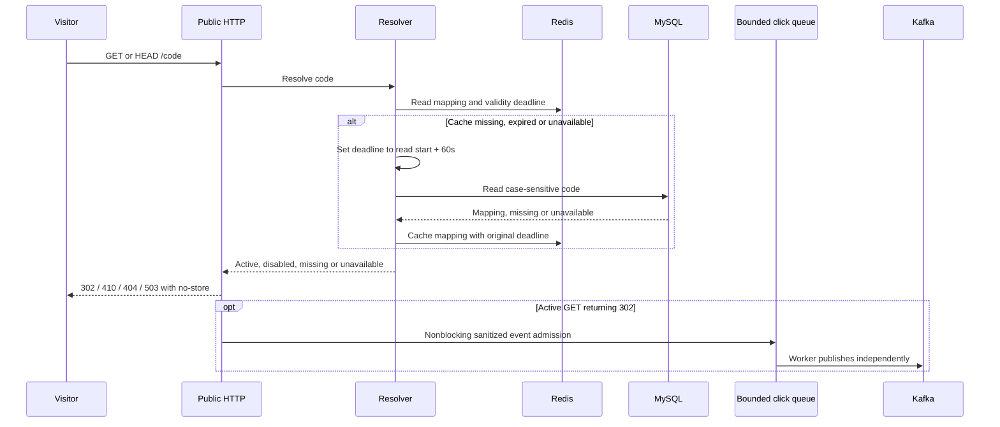

# Public redirects and asynchronous clicks

Implements [#14](https://github.com/DiiKhanh/worklane/issues/14), following the
[approved specification](../roadmap/2026-11-15-link-service-mvp-scope.md) and
[ADR 0001](../adr/0001-link-redirects-and-best-effort-analytics.md). Tenant
management is described in [link-management.md](link-management.md).
Analytics persistence, dashboard integration and stack routing remain in
#15-#17. This increment performs no production deployment.

## Public HTTP behavior

| Resolution | GET /:code | HEAD /:code |
| --- | --- | --- |
| Active | 302, exact accepted `Location`, click admission | Same status and Location, no click |
| Disabled | 410 | 410 |
| Confirmed missing or structurally invalid code | 404 | 404 |
| Resolution unavailable | 503 | 503 |

All these responses have `Cache-Control: no-store` and an empty body. Writing
Location directly avoids redirect helpers that normalize the accepted URL or
generate HTML. Codes retain case-sensitive lookup semantics. There is no
destination fetch, DNS validation or authentication on public redirects.

## Cache validity and permanent disable

The cache stores the mapping, including destination, tenant and disabled state,
and an absolute `ValidUntil` deadline. Its maximum age is 60 seconds from the
start of the authoritative MySQL read. Hits do not write or extend this deadline.
Creation deliberately does not warm the cache, leaving a single refill path.

Redis writes atomically set the value and its absolute millisecond expiry with
Lua `SET` and `PEXPIREAT`. This works with Redis 5 as well as newer servers.
The resolver independently checks the embedded deadline before serving, after
cache reads and after cache writes. A read that finishes after its deadline
returns 503. Corrupt cache entries fall back to MySQL.

Disable commits to MySQL before eviction. Eviction can fail, and an older
in-flight read can refill active state after eviction or overwrite a newer
disabled cache entry. That older snapshot retains its original deadline:
if its read began at T, it cannot serve at or after T + 60 seconds. Since it
preceded the disable commit, it also cannot exceed the disable deadline. This
bound does not require a distributed lock, tombstone or successful eviction.

Redis failure falls back to MySQL. During a MySQL outage, unexpired cached
active state returns 302 and unexpired disabled state returns 410; expired or
unresolvable state returns 503. No negative cache is written for missing codes.
Cache reads and writes each have a 100 ms budget, and authoritative reads have
a two-second budget. The production Redis client honors context deadlines.
Absolute deadlines assume service and Redis hosts have synchronized wall clocks;
the application deadline check also protects against a late Redis expiry.



## Privacy and bounded emission

Only GET responses returning an active 302 admit `link.ClickedEvent`. Before
admission, referrers become an HTTP/HTTPS origin with credentials, path, query
and fragment removed; missing or invalid referrers become an empty origin.
Raw User-Agent becomes desktop, mobile, tablet or unknown. Bots and unrecognized
agents are unknown. Oversized metadata is unknown. The event contains only
code, tenant, UTC timestamp, referrer origin and device category. Destination,
raw referrer, raw User-Agent and IP/IP hash never enter the queue or Kafka.

The emitter has one worker and a queue capacity of 256 in the composition root.
Admission is a nonblocking channel send. Full queues lose events; requests
never wait for Kafka. The worker gives each publication two seconds and never
retries events. Its Kafka adapter uses the existing envelope and code partition
key, requests broker acknowledgement, bounds transport/metadata operations to
one second, and disables producer retries. Internal producer channels and
batches are bounded. Initial Kafka metadata lookup is deferred until publication,
so a Kafka outage does not prevent redirect startup.

Shutdown stops admission, drains within the shared ten-second process shutdown
budget, then cancels remaining work. Producer completion channels continue to
be drained, including after a publication times out. There are no per-event
goroutines. Cancellation or a lost acknowledgement can leave delivery uncertain,
as permitted by best-effort analytics.

`/metrics` exposes `link_click_published_total` and `link_click_dropped_total`
with fixed `overflow`, `publish` and `shutdown` reasons. Shutdown logs aggregate
counts only. Broker errors and event payloads are not logged. HTTP panic recovery
also avoids Gin's default request-header dump. There are no raw-request logs.

## Trusted ingress and routing boundary

The backend disables forwarded-IP interpretation and trusts no proxies. Arbitrary
`X-Forwarded-For`, `X-Real-IP` or provider-specific headers cannot establish a
trusted client identity in this process.

The routing increment in #17 must apply the agreed 100 requests/second per
trusted client IP, burst 50, before public GET/HEAD reaches the service. At a
direct Traefik edge, use its connection peer as the rate-limit source, without
a request-header source criterion or X-Forwarded-For depth override. If another
load balancer precedes Traefik, configure only its explicit trusted CIDRs and
have it replace or safely append forwarding headers; never enable insecure
forwarded-header trust. Backend access must be restricted to that ingress.
Those access-control and production routing changes require the separate rollout.
Rate-limited requests must terminate before click admission and carry no-store.
IP addresses remain transient ingress state, outside analytics and application
logs. The backend does not add a second IP limiter that would share a bucket
across requests forwarded by the same ingress connection peer.

## Verification

The agreed seams are public HTTP, Redis mapping operations and the emitter's
public interface, plus isolated MySQL/Redis/Kafka adapters. Tests cover exact
Location and HEAD behavior; status distinctions; sanitized queue admission;
queue overflow and shutdown; cache corruption, stalls, expiry and outages; and
concurrent disable followed by a stale active refill during database failure.
The integration race test pauses an actual MySQL snapshot, disables through
HTTP, caches disabled state, releases the older read, then closes the database
and advances an injected clock to the original deadline.

```sh
make test-link
make test-link-integration
make test-link-schema
go build ./...
go vet ./...
make test
```

Tagged integration tests start isolated containers by default. Local disposable
MySQL/Redis can be selected as described in [link-management.md](link-management.md).
`LINK_TEST_KAFKA_BROKERS` can select a dedicated disposable Kafka instance instead
of Redpanda testcontainers. The Kafka test creates `link.clicked` with one
partition, tolerates that topic already existing, and consumes from the current
end offset. These overrides must never point at production or a shared cluster.
The Kafka test checks the real key, envelope, payload allowlist and GET-only
publication through HTTP.

### Local acceptance evidence

Verified on 2026-11-21 with Go 1.25.0, isolated MySQL 8.0.42 over a Unix socket,
isolated Redis 5.0.7 and isolated Apache Kafka 3.9.0 over loopback. This host
does not provide Docker, so container startup was not exercised. All service
adapters used their real dependencies; only identity introspection used the
existing HTTP contract fixture. Deadline tests advanced an injected clock rather
than waiting a minute. The test suite does not claim a production timing SLA.

| Check | Result |
| --- | --- |
| `make test-link` | Passed with the race detector |
| `make test-link-integration` | Passed with the race detector and real MySQL, Redis and Kafka |
| `make test-link-schema` | Passed against isolated MySQL |
| `go build ./...`, `go vet ./...` | Passed |
| `make test` | Full default backend suite passed |
| Mermaid sequence diagram | Rendered and visually inspected |

The five-minute warm-cache measurement, dashboard acceptance and production
routing remain in #17. No production data mutation or deployment was performed.
