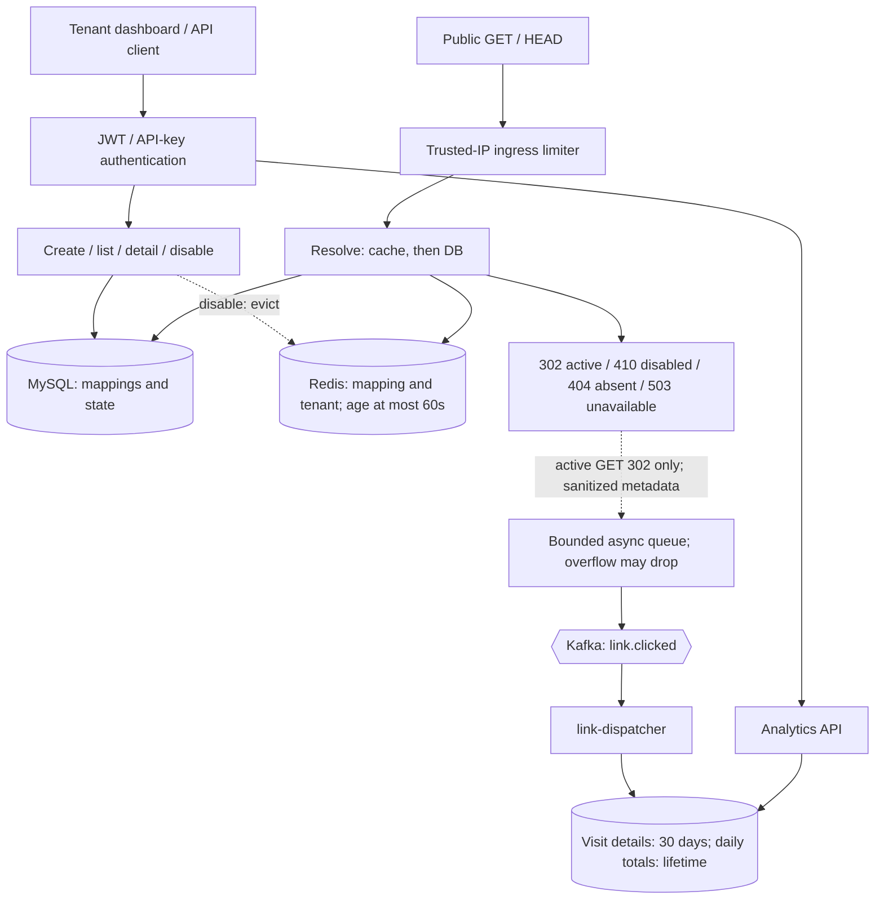

# Link Service MVP scope

Date: 2026-11-15.
Status: consolidated MVP scope confirmed by the owner on 2026-11-15.
Published specification and delivery tracker:
[#11](https://github.com/DiiKhanh/worklane/issues/11).

## Confirmed scope direction

The owner resumed Link Service design on 2026-11-15, starting from the
[existing design](../superpowers/specs/2026-08-19-link-service-url-shortener-design.md).
The owner confirmed the consolidated scope before ticket breakdown.
Backup/restore and real SMS remain deferred and unverified, as recorded in the
[milestone assessment](2026-11-15-issue-10-milestone-readiness.md).
The owner subsequently authorized GitHub spec/ticket publication and committing
the supporting documentation. Code implementation and production deployment
remain outside this publication task.

This scope supersedes conflicting first-cut requirements in the
original design. The original remains the architectural baseline elsewhere.

## Existing baseline

The existing design specifies tenant-scoped creation and deduplication, public
302 redirects, Redis caching and asynchronous click analytics. Template
auto-shortening, notification CTR, geolocation, vanity aliases and expiry are
deferred in that design.

## Confirmed MVP decisions

### Product and audience

- Deliver the API and a live Links dashboard with creation, copying, listing and
  click analytics. Remove fixture-only CTR and geolocation indicators from the
  MVP experience; do not present sample values as real analytics.
- Creation is limited to tenants provisioned by the project owner. Redirects
  remain public. Self-service registration is outside this MVP.
- Click counts describe recorded redirect visits, including repeated requests,
  bots and previews. Analytics is eventually consistent and best-effort: failed
  publication can lose events and Kafka redelivery can duplicate them. Counts
  are not unique-human counts or reconciliation-grade totals. Successful
  redirects take priority over analytics delivery.

### Destinations, lifecycle and resilience

- Accept absolute HTTP/HTTPS destination URLs with a hostname and no embedded
  credentials. Reject localhost, literal internal IP addresses and the configured
  short host. The service does not fetch destinations, check availability,
  resolve DNS for validation or scan phishing/redirect chains. Public links do
  not protect destination confidentiality; destinations enforce their own auth.
- Destination mappings are immutable. Codes are never deleted or reused. Add
  tenant-scoped disabling to the MVP, preserving history; re-enabling is deferred.
  This extends the existing design's lifecycle.
- Deduplicate exact accepted destination strings within a tenant. Preserve
  query order, fragments and trailing slashes. Different tenants receive distinct
  mappings even for identical destination strings.
- Analytics includes lifetime recorded click totals, a 14-day UTC series
  including today and the 20 most recent visits. Provide manual refresh, with
  visibility within 10 seconds under normal pipeline operation; realtime updates
  are deferred.
- Redis failure falls back to MySQL. A valid cached mapping can serve redirects
  while MySQL is unavailable. Return 503 when neither can resolve a mapping;
  only a confirmed missing code returns 404. Kafka failure or a full bounded
  analytics queue may lose clicks but must not prevent redirect responses.
  The existing synchronous Kafka producer cannot be called on the redirect
  response path to satisfy this requirement.

### Revocation, privacy and verification

- Disabling takes effect for new requests within 60 seconds of successful
  completion. Evict on disable and bound cache age to 60 seconds, replacing the
  original one-hour TTL. Disabled public links return 410 Gone. Previously
  issued redirects cannot be recalled.
- Creating the exact destination of an existing disabled link returns
  409 LINK_DISABLED. Do not re-enable it or issue a replacement code.
- Retain visit details for 30 days and daily aggregates for the link lifetime.
  Store timestamp, referrer origin and device category only. Do not retain raw
  User-Agent, referrer path/query or IP/IP hash in analytics. IP may be used
  transiently for rate limiting. This replaces the original ip_hash decision.
- Record clicks only for active-link GET requests returning 302; HEAD redirects
  without recording a click. Errors, rate-limited requests and disabled links
  do not count. Redirect responses carry Cache-Control: no-store.
- Analytics failures render an unavailable state, never a fabricated zero.
  Link metadata and copying remain usable when independently available.
- Acceptance uses the live dashboard against isolated real MySQL, Redis and
  Kafka: create, copy, redirect, observe analytics and disable. Verify tenant
  isolation, concurrent deduplication and agreed dependency-failure behavior.
  Run a warm-cache baseline of 50 redirects/second for five minutes without
  fault injection, recording latency and error rate. No production SLA is
  asserted. Production rollout is a separate step requiring its own approval.

### Limits

- Creation defaults to 10 requests/minute/tenant, including dedup requests.
  The quota is configurable. Exceeding it returns 429 with Retry-After;
  unavailable quota storage returns 503. This does not remove redirect fallback
  to MySQL. Use an atomic fixed-window counter.
- Public redirect ingress starts at 100 requests/second per trusted client IP,
  burst 50. Arbitrary forwarded headers must not select the rate-limit bucket.
- Destination URLs are limited to 4,096 UTF-8 bytes. Reject control characters
  before constructing Location headers. List pagination uses cursors, 20 default,
  100 maximum, newest first with a stable tie-breaker.
- New mappings return 201; dedup of an active mapping returns 200. Search,
  advanced filters and export are outside MVP.

## Consolidated delivery boundary

Deliver a standalone shortener with a working Links dashboard: create, copy,
list, inspect analytics and permanently disable. Use existing JWT/API-key
authentication for existing owner-provisioned tenants. No separate Links
enrollment, entitlement system or self-service signup is introduced.

Retain two deployables, link-svc and link-dispatcher, a service-owned MySQL
database, Redis cache-aside reads, Snowflake IDs encoded as Base62, and Kafka
link.clicked. Service boundaries and hexagonal layout remain as specified in
the original design. Production hostname, DNS and routing changes belong to
the separate rollout step; short URLs use configured LINK_PUBLIC_BASE.

Tenant identity always comes from authentication, never supplied tenant IDs.
Foreign tenant codes appear absent on management and analytics routes. Existing
identity revocation/cache semantics apply; no immediate credential-revocation
claim is added. Codes and destinations are public, not access controls.

| Route | Behavior |
| --- | --- |
| POST /v1/links | Body {long_url}; 201 new, 200 active dedup, both with {code, short_url}; 409 LINK_DISABLED for disabled dedup. |
| GET /v1/links | Owned metadata and state, cursor-paginated. |
| GET /v1/links/:code | Owned metadata and state, independent of analytics availability. |
| GET /v1/links/:code/analytics | Lifetime total, 14 UTC daily buckets and up to 20 recent visits. |
| POST /v1/links/:code/disable | Permanently disable an owned link; repeating the request succeeds without reactivation. |
| GET /:code | Public 302 active, 410 disabled, 404 confirmed absent, 503 resolution unavailable. |
| HEAD /:code | Same resolution/status/Location behavior without a body or recording a click. |
| GET /healthz | Public process health following repository conventions. |

The separate analytics route supports independently available metadata and
copying. Dashboard list/detail show active/disabled states; disabling has a
confirmation before submission. Include loading, empty, unavailable and retry
states. No fixture data is presented as real analytics. Remove CTR, geography,
message attribution and any sample KPI without a live source. Tenant data must
not appear in another tenant's cached views, including after logout/login.

## Reporting and privacy details

Clicks measure server redirect responses, not proof that a person received a
response or loaded the destination. No unique-human, delivery or reconciliation
claim is made. Normal-operation visibility is within 10 seconds, not an outage
guarantee. Manual refresh is sufficient; realtime subscriptions are deferred.

The series uses event time in UTC and includes today plus the preceding 13 days,
with missing days filled with zero. Recent visits sort newest first within
retained details. An old link may have an empty recent list and a nonzero total.

Sanitize before enqueueing/publishing: retain only timestamp, HTTP/HTTPS referrer
origin and device category. Missing/invalid referrers become unknown. Raw
referrer path/query/credentials, User-Agent and IP/IP hash must not reach
analytics storage, Kafka payloads or application logs. Raw-event retention,
including Kafka, must not exceed 30 days. Expiring visit details never reduces
daily/lifetime aggregates. Detailed records older than the retention window
must not be recreated by delayed delivery.

URL validation covers IPv4 and IPv6 literal non-public/internal addresses.
It does not resolve hostnames: a hostname can still resolve privately. Indirect
redirect loops are also outside validation. These limitations do not introduce
server-side fetching of destinations.

## Architecture and consistency constraints

The diagram separates redirect responses from analytics delivery; queue
admission must not wait for Kafka. Analytics tables and mappings reside in the
same service-owned database, shown separately for readability.

- Cache entries include tenant ID, destination, state and a validity deadline.
  A destination-only cache cannot construct the agreed event on a hit.
- Cache age is at most 60 seconds from the authoritative read's start, not a
  delayed cache write. Never extend validity on hits, stale refills or failed
  reads. Create warming follows the same rule. Disable commits to MySQL before
  success and attempts eviction; cache races must not extend the disable bound.
- Expired mappings are never served during DB failure. An unexpired cached
  active/disabled state may still serve its corresponding response. Use 503
  when no authoritative resolution is available, not a fabricated 404.
- The existing synchronous Kafka publisher cannot run on the redirect response
  path. Use bounded async admission/workers, bounded shutdown and observable
  drops/failures; no unbounded goroutines, queues or retries per click.
- Persist a consumed event's aggregate increment and retained detail in one
  transaction. Commit consumer progress after persistence; redelivery can still
  double-count as accepted. Cleanup preserves aggregates.
- Base62 code storage/lookups must be case-sensitive. Enforce tenant/hash
  uniqueness and verify original-string equality on hash-based dedup. Concurrent
  duplicate inserts resolve to dedup, not generic creation failures.
- Snowflake node IDs remain unique per instance. Do not issue IDs under
  clock/sequence conditions that could violate uniqueness. Codes are not secrets.
- Validate HTTP/event boundaries, bound input/query sizes, parameterize database
  access and redact sensitive destinations in logs. No destination fetching.
- Send Cache-Control: no-store for redirects. Avoid downstream caching of
  disabled/missing responses so status recovery does not depend on a CDN/browser.

See [ADR 0001](../adr/0001-link-redirects-and-best-effort-analytics.md) for the
redirect/analytics consistency trade-off. These are implementation constraints,
not claims of implemented behavior.

## Acceptance and completion

Use repository test/build/lint/typecheck entry points. Full-stack verification
uses the live dashboard and isolated real MySQL, Redis and Kafka. No production
send, data mutation or deployment belongs to this acceptance run.

1. Create, copy and follow a real link; repeat creation returns the same code.
   Verify tenant isolation, concurrent dedup and case-sensitive Base62 identity.
2. Observe GET clicks in total, UTC series and recent visits within 10 seconds
   under normal operation. HEAD does not count. Distinguish real zero from
   unavailable analytics.
3. Disable, observe 410 within 60 seconds, preserve history and reject recreation
   with 409. Exercise concurrent cache refill, expiry and DB outage to verify
   that the redirect cannot outlive the agreed disable bound.
4. Verify URL limits/rejections, ownership, pagination, rate limits and public
   status distinctions. Inspect loading, empty, error/retry and tenant-switch
   states in the browser.
5. Inject Redis/MySQL/Kafka failures and analytics queue overflow. Verify the
   availability policy and bounded resource use.
6. Verify sanitization before publication/storage and 30-day detail expiration
   without reducing aggregates, including delayed delivery and redelivery.
7. Run the agreed warm-cache 50 redirects/second baseline for five minutes without
   fault injection. Record environment, achieved rate, latency and errors; this
   is a measurement, not a production SLA.

Inspect the rendered dashboard and implementation diff before completion.
Production rollout, DNS and production smoke require a separate concrete
procedure and approval. GitHub spec/ticket publication is separately authorized
by the owner and does not constitute implementation evidence.

## Deferred scope and next step

Backup/restore; real SMS and phone verification; general Notification Service;
template auto-shortening; notification attribution/CTR; unique-human analytics;
geolocation; vanity aliases; expiry; 301 redirects; editing/re-enabling/deleting/
reusing codes; self-service registration; search/export; phishing scanning;
realtime updates; sharding/replication and production SLA commitments.

All product decisions are resolved and the consolidated interpretation is
confirmed. The [ticket breakdown](2026-11-15-link-service-ticket-drafts.md)
provides the implementation work packages. The owner separately authorized
GitHub publication and the documentation commit; code implementation and
production rollout remain separate.
