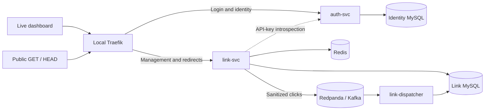

# Link Service MVP verification

The [approved MVP](https://github.com/DiiKhanh/worklane/issues/11) defines the
behavior covered by [isolated stack verification](https://github.com/DiiKhanh/worklane/issues/17).

## Local stack

The `links` Compose profile builds the two Link deployables and a live-mode
dashboard. `link-svc` migrates its own MySQL instance using the account provisioned
by the MySQL image. The Link database uses no binary log, so the schema owner
can install the immutability triggers with database-local privileges.
Identity remains in the shared local auth service. Redis serves Link cache and
create quota, and Redpanda supplies the Kafka API for `link.clicked`.



The gateway uses the directly connected peer IP for the redirect limiter at
100 requests per second with a burst of 50. Local ingress accepts no trusted
forwarding proxies. The management router exposes the API's `Retry-After` header
to cross-origin browser requests. The gateway publishes Link health at
`/healthz`. Link process metrics remain on the Compose network.

From the repository root, export throwaway values for `MYSQL_ROOT_PASSWORD`,
`LINK_DB_ROOT_PASSWORD`, `LINK_DB_PASSWORD`, and `INTERNAL_API_TOKEN` in the shell.
Hex strings generated with `openssl rand -hex 24` work in Compose and the test
DSNs. Generate local Ed25519 JWT keys as described in the README, or set
`AUTH_SECRETS_DIR` to an absolute directory containing `auth_priv.pem` and
`auth_pub.pem`. Keep the same credentials for the life of the project volumes.
[Local key setup](../../README.md#start-the-local-backend-stack)

```sh
export COMPOSE_FILE=deploy/compose/docker-compose.yml
export COMPOSE_PROJECT_NAME=worklane-links-local
export COMPOSE_PROFILES=links
export WORKLANE_GATEWAY_PORT=19780 WORKLANE_DASHBOARD_PORT=19781
export WORKLANE_MYSQL_PORT=19782 WORKLANE_LINK_MYSQL_PORT=19783
export WORKLANE_REDIS_PORT=19784 WORKLANE_KAFKA_PORT=19785 WORKLANE_TRAEFIK_PORT=19786
export E2E_API_BASE=http://127.0.0.1:19780
export LINK_PUBLIC_BASE="$E2E_API_BASE" WORKLANE_DASHBOARD_API_BASE="$E2E_API_BASE"
export LINK_E2E_DASHBOARD=http://127.0.0.1:19781
export MYSQL_DSN="root:$MYSQL_ROOT_PASSWORD@tcp(127.0.0.1:$WORKLANE_MYSQL_PORT)/identity?parseTime=true"
export LINK_E2E_MYSQL_DSN="links:$LINK_DB_PASSWORD@tcp(127.0.0.1:$WORKLANE_LINK_MYSQL_PORT)/links?parseTime=true"
docker compose up -d --build dashboard link-dispatcher
```

The dashboard API origin is inlined at build time. Rebuild the dashboard after
changing the gateway's browser-facing origin. Wait for `/healthz` to return 200,
`/auth/login` to reject a well-formed, unknown login with 401 and the
`link-dispatcher` group to show Stable in `rpk group describe`. Run
`make test-link-e2e` against the disposable stack. Its analytics outage case
renames and restores the visit-detail table. Keep the stack exclusive to the
verification run.

For the browser check, seed two fresh tenants with `go run ./services/seed`
using `MYSQL_DSN`. Export the users' addresses as `LINK_E2E_EMAIL` and
`LINK_E2E_SECOND_EMAIL` and their shared throwaway password as
`LINK_E2E_PASSWORD`. From `dashboard/`, run `pnpm install --frozen-lockfile`,
`pnpm exec playwright install chromium`, and `pnpm test:links-e2e`. From the
repository root, `docker compose down -v` removes the disposable project.

## Verification coverage

| Area | Verification |
| --- | --- |
| Runtime and gateway | New Compose builds, health routing, gateway API lifecycle, browser clipboard, `Retry-After` CORS and a burst with distinct forged forwarding headers over one peer IP |
| Tenant boundaries and creation | API lifecycle and browser tenant switch, plus `TestManagementTenantIsolationAndConcurrentDedup`, `TestManagementAtomicQuotaIncludesDedup`, `TestManagementQuotaWindowExpires`, and schema tests |
| Redirect consistency | `TestRealRedirectCacheAndDatabaseOutage`, `TestRealRedirectDisableAndRedisOutage`, `TestRealDisableStaleRefillAndDatabaseOutage`, and gateway status checks |
| Dependency failure | `TestManagementRedisFailureKeepsMetadataAndDisableAvailable`, `TestHTTPRedirectsSurviveUnavailableKafka`, and `TestHTTPRedirectsDoNotWaitForKafkaOrQueueCapacity` |
| Analytics privacy and retention | `TestHTTPClickReachesIsolatedKafkaWithSanitizedPayload`, `TestEventTimeUsesUTCAndTopicRetentionIsBounded`, `TestDetailExpirationPreservesTotalsAndLateEventsCannotRecreateDetails`, and dispatcher redelivery tests |

## Local results

The pre-change gateway sent `/v1/links` to OTP, left public short paths unrouted,
and omitted CORS exposure for `Retry-After`. The final gateway routed Link
requests and kept `/metrics` on the service network. In the forged-header
burst, one peer sent 200 HEAD requests with distinct claimed IPs in 76 ms.
Traefik admitted 56 and returned 429 for 144, within the configured refill and
burst allowance.

- The API suite observed one GET click in 107 ms and a 410 in 1 ms after
  disable. HEAD preserved the destination with no recorded click, a foreign
  tenant received 404 for detail, analytics, and disable, and disabled
  recreation returned `409 LINK_DISABLED`.
- The rendered dashboard in isolated Headless Chrome 158 created a link,
  copied it, and showed the sanitized mobile visit in 1.075 seconds after
  manual refresh. During an isolated visit-table outage, metadata and Copy
  remained visible with an analytics Retry action. Retry recovered after
  restoration. The disable dialog, disabled state, recreate conflict, and
  second tenant's empty view were inspected. Browser network throttling made
  the loading skeleton observable. A cross-origin browser request
  read `Retry-After: 60` from the quota's 429 response.
- With Redis stopped, public resolution fell back to MySQL (302), metadata
  remained available (200), and creation returned 503. An initial 5-second
  client timeout was too short for the API-key path, which returned 503 in
  5.51 seconds on measurement. The JWT path returned 503 in 1.78 seconds.
  With Link MySQL stopped, a warm mapping returned 302 and an uncached code
  returned 503. After recovery, the missing code returned 404.
- With Redpanda stopped, 641 GETs over eight seconds all returned 302 with the
  correct location. By the end of the run, queue overflow increased by 304
  and unconfirmed publication increased by 83. Shutdown drops and acknowledged
  publications were unchanged. Remaining queued or in-flight events account
  for the difference between total requests and the instantaneous counters.
  An earlier fault run also had zero HTTP errors and one unsent load iteration.
  The first broker recovery exposed an exited dispatcher. With Compose
  `restart: on-failure`, the dispatcher restarted and its group returned to
  Stable with zero lag after the broker came back. One post-restart click
  still failed to publish. Five subsequent probes published and drained,
  and the API lifecycle passed again once the pipeline settled.
- The active Redpanda topic reported delete cleanup, seven-day retention,
  hourly segment rolling and broker append timestamps. Redpanda v23.3.3 omits
  Apache Kafka's per-topic file deletion delay. The integration assertion
  still checks the delay when reported and always checks the shared settings.
  An accelerated synthetic topic advanced the log start offset from 0 to 20
  after expiry. MySQL feature tests exercise detail expiry, delayed delivery,
  and aggregate preservation using controlled timestamps.
  [Redpanda topic properties](https://docs.redpanda.com/streaming/23.3/reference/topic-properties/)

### Repository checks

- Backend passed `make test`, `make test-link`, `make test-link-schema`,
  `make test-link-integration`, `go build ./...`, and `go vet ./...`.
  Docker integration first exposed the broker-specific assertion and then a
  race between packages starting the same Testcontainers reaper. The
  broker-aware assertion and serialized Make target passed the full rerun.
  The gateway test also leaves time for its peer bucket to refill after
  the forged burst, so the next test starts with a full allowance.
- Dashboard frozen install, typecheck, lint, all 89 Vitest tests, and the
  mock-mode build passed. The live dashboard image built and ran against
  the isolated gateway. The workflow runs the browser regression in Chromium.
- The legacy email E2E passed through local MailHog. Compose validation,
  workflow lint, diagram rendering, and the diff review passed.

### Warm-cache baseline

The baseline ran from 20:13:47 to 20:18:47 UTC on 2026-11-27 on an Apple M2
with macOS 15.7.9, Docker Engine 29.9.3 and Compose 5.7.0. Docker reported 8
CPUs and 7.75 GiB RAM. The isolated stack ran MySQL 8.0.46, Redis 7.4.10,
Redpanda v23.3.3, and Traefik 3.1.7. k6 2.3.0 sent GETs through localhost
Traefik to one pre-warmed code, with redirects unfollowed and no fault injection.

| Measurement | Result |
| --- | ---: |
| Scheduled rate and duration | 50/s for 5 min |
| Completed redirects and achieved rate | 15,001 at 50.003/s |
| Average, p50, p95, p99 and maximum HTTP duration | 1.40 ms, 0.97 ms, 2.06 ms, 10.89 ms and 114.51 ms |
| HTTP errors, unexpected status/Location, and unsent iterations | 0 |
| Kafka acknowledgments and recorded lifetime clicks | 15,001 each |
| Analytics drops by reason | 0 overflow, 0 publication, 0 shutdown |

The measurement includes local Docker networking and one active mapping. The
cache lease can refresh during the run. The final route boundary checks for
`/metrics` and Auth/OTP prefixes followed this run. These measurements apply
to the local baseline. Analytics delivery remains best-effort, with possible
loss or duplicate counts.

## Rollout boundary

Verification used disposable local and CI configuration. No production rollout,
DNS mutation, real SMS, or backup/restore work occurred. Production rollout
requires separate approval and a rollout procedure.
